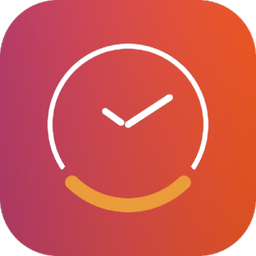

<div align="center">



# Cadran

**A clock on your Mac wallpaper.**

25 clock faces drawn on your macOS wallpaper - behind your icons, on every Space and display, always visible, never in the way.

[Website](https://cadranapp.com) &nbsp;&middot;&nbsp; [Download](https://cadranapp.com/api/download/latest) &nbsp;&middot;&nbsp; [What's New](https://cadranapp.com/changelog) &nbsp;&middot;&nbsp; [Report a Bug](https://github.com/Ilyomix/Cadran-releases/issues/new?template=bug_report.yml) &nbsp;&middot;&nbsp; [Request a Feature](https://github.com/Ilyomix/Cadran-releases/issues/new?template=feature_request.yml)


[](https://formulae.brew.sh/cask/cadran)

[](https://github.com/jaywcjlove/awesome-mac/pull/1914#event-24241286709)

</div>

---

## What is Cadran?

Cadran turns your Mac desktop into a clock you always see. Pick from **25 faces** in six categories - Numeric, Analog, Data, Abstract, Matrix and Spectrum - each made to sit quietly on your wallpaper, not to compete with your work.

### New in 2.0

- **Five new faces** - Régulateur, Folio, Méridien, Secteur and Aperture
- **Stencil and Carbon retired** - wherever you used one of them, Cadran now shows Departure; Pro unlocks all 25 faces
- **A clock in Liquid Glass** - on macOS 27, with Cadran Pro, nine faces offer Liquid Glass in their Material row, to draw the clock in glass over your wallpaper, like the clock on the Lock Screen. Automatic Color takes your wallpaper's dominant color, with a shadow that keeps it readable
- **A redesigned app** - a new gallery, one editing bar on your desktop, Settings inside the Cadran window, and a guided tour
- **A screen saver page** - edit your screen saver full size, and install or remove it from its status menu
- **Your own message** - anywhere on the desktop, or under the clock on your screen saver
- **11 languages** - now with Simplified Chinese, Traditional Chinese and Arabic

[Read the full release notes](https://cadranapp.com/changelog)

### Highlights

- **Wallpaper-layer rendering** - lives behind your icons, not on top
- **Weather, calendar and more** - live weather, your next event, battery, music and astronomy on the face
- **38 built-in backgrounds (21 free)** - solids, gradients and a Dynamic Sky that follows the sun, plus custom colors and gradients with Pro
- **One face per display** - give each screen its own face with Pro
- **Screen saver** - 24 faces, following your desktop or with a look of its own
- **Energy-friendly** - can pause when the clock is hidden

### Privacy-first

No account. No ads. No telemetry. Your settings stay on your Mac. Cadran goes online only to fetch the weather (if you turn it on), to check a Pro license, and to look for updates.

### Pricing

| | Free | Pro (€9.99 one-time) |
|---|---|---|
| Clock faces | 6 | All 25 |
| Clock colors | Automatic Color | Palettes and custom colors |
| Backgrounds | 21 included | All 38, plus custom colors and gradients |
| Information on the face | 3 options | Every option |
| Position and size | Fixed | Move & Resize, on compatible faces |
| Multiple displays | The same face | One face per display |
| Screen saver | Yes | Yes |

Pay once, no subscription. Reference price before tax: your local price, currency and taxes are shown at checkout. One license works on up to 3 Macs.

---

## Download

Grab the latest release:

**[Download Cadran.dmg](https://cadranapp.com/api/download/latest)**

Or install with [Homebrew](https://brew.sh):

```bash
brew install --cask cadran
```

> Requires **macOS Sonoma 14.0** or later. Runs on Apple Silicon and Intel Macs.

---

## Feedback & Issues

This repository is the public issue tracker for Cadran. The source code is private, but you can report bugs and request features here. In the app, **Help › Report a Bug…** opens the bug form on cadranapp.com.

### Using GitHub Issues (Web)

1. Go to the [**Issues** tab](https://github.com/Ilyomix/Cadran-releases/issues)
2. Click **New Issue**
3. Choose a template: **Bug Report** or **Feature Request**
4. Fill in the details and submit

### Using the `gh` CLI

If you have the [GitHub CLI](https://cli.github.com) installed, you can file issues directly from your terminal:

```bash
# Report a bug
gh issue create --repo Ilyomix/Cadran-releases \
  --template bug_report.yml \
  --title "Brief description of the bug"

# Request a feature
gh issue create --repo Ilyomix/Cadran-releases \
  --template feature_request.yml \
  --title "Brief description of the feature"

# Quick issue (no template)
gh issue create --repo Ilyomix/Cadran-releases \
  --title "Your title" \
  --body "Describe the issue or idea"
```

> **Tip:** Run `gh issue list --repo Ilyomix/Cadran-releases` to check existing issues before creating a new one.

### Before submitting

- Search [existing issues](https://github.com/Ilyomix/Cadran-releases/issues) to avoid duplicates
- Include your **macOS version** and **Cadran version** (Cadran › About Cadran) for bug reports
- One issue per report - it helps us track and resolve things faster

---

## Links

- [Website](https://cadranapp.com)
- [What's New](https://cadranapp.com/changelog)
- [Privacy Policy](https://cadranapp.com/privacy)
- [Terms of Service](https://cadranapp.com/terms)
- [Support](https://cadranapp.com/support)

---

<div align="center">
<sub>Made by <a href="https://github.com/Ilyomix">Ilyes Abd-Lillah</a> in Toulouse, France.</sub>
</div>
